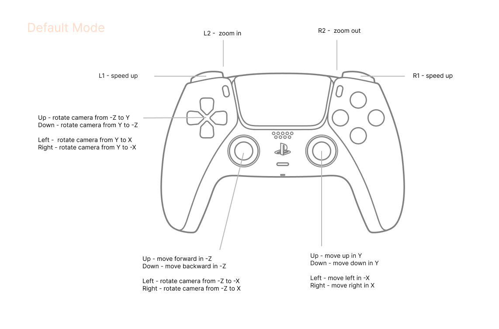

## WebGPU SDF example

Live demo https://r.tiye.me/Triadica/soluble/ .

### 开发与部署

使用配对的正式 Calcit / @calcit/procs 0.41.1、Node.js 24 和 Yarn 4.18.0，
不应混用旧 alpha 编译器与正式 runtime。
Respo 0.19.5、Reel 0.11.0、UI 0.15.2 和 js-ffi 0.2.13 使用精确正式版本。
UI 的发布依赖图使用 Router 0.12.2，Vite 固定 8.3.3。
请重新安装完整图并重建，UI 基础样式升级可能影响外观，不承诺逐像素相同。
导航显隐和开发面板使用 `Option`，状态路径使用 Respo 的 `CoordKey`。URL 仍使用原标签 ID。前端重建后可沿用原链接。 标签点击使用具名 `Op`，应用派发使用 `Op | reel.typed/Control`。 应用分发与 Reel 控制分别走具名回调，旧匿名 Reel 控制随 0.11.0 退役。

#### 0.32.1 迁移记录

本轮同步 0.32.1 的类型标注语法，并显式标注原有开放 dispatch 类型槽：入口同时接收应用操作和 Reel 匿名控制消息，
保持既有 Fn<Dynamic,Unit> 合同；现有 Enum 检查和解码后才进入 app.schema/Op / reel.typed/Control，
不把开放入口冒称为单一封闭名义类型，也不向业务 Store 或 updater 扩散 Dynamic。
38 个定义的执行代码和公开 schema 保持不变。原三项测试名称、标签和断言数量保留，
仅将 get-in 成功断言的旧 Option(:some true) 更新为现合同 Result(:ok true)，仍验证同一路径和值。
此前迁移已清理旧 Option 调用、String→Tag 转换及集合长度写法，这些历史说明不代替本轮验收。
公开 schema、实际 `hud!`、59 个场景目录及原三项测试覆盖保持；不添加强转、质量预算或校验脚本。
触控 npm 包仍受 [#31](https://github.com/WebGPU-Art/soluble/issues/31) 的正式发行缺口约束，不猜测不同 API 的替换包。
原图片 URL、手柄算法和存储/部署路径不因工具链升级改变。运行 `caps --strict --ci`、
`yarn install --immutable` 后，`yarn dev` 启动页面；另一个终端运行
`yarn watch` 监听 Calcit 源码。`yarn build` 编译 Calcit、TypeScript 和前端资源。
Calcit 源码与依赖分别保存在 `calcit.cirru`、`deps.cirru`；`js-out/`、`lib/` 和
`dist/` 都是忽略的生成目录，不提交到仓库。

生产构建使用 `VITE_BASE_URL=https://cos-sh.tiye.me/WebGPU-Art/soluble/`。
仅前端 `dist/` 上传 COS，上传 action 的 `public-base-url` 负责内容校验，
没有独立 CDN 校验脚本。原 rsync 服务器路径保持不变。PR 只检查和构建，不部署；
PR artifact 使用相对资源路径，下载后可直接由本地 HTTP 服务加载，不依赖未上传的 PR CDN 资源。
生产任务串行且不中途取消：开始上传前检查 main revision；开始后完成同一 revision
的 COS 和服务器部署，新提交排队处理。这不是与 main 原子同步的保证。

TypeScript/WGSL 渲染层、原图片资源 URL 和手柄行为不因 CDN 前缀配置而改变。
本轮另启用 TypeScript `strictNullChecks`：GPU 资源在初始化前/释放后真实可为 `null`，
不能再当作已就绪句柄使用。TypeScript 消费者须先检查 `deref()` 结果，或在初始化成功的路径
使用会实际检查缺失值的 `derefRequired()`；`createRenderer.onButtonEvent` 与场景合同一致为可选。
`SolubleObjectData.indices` 修正为既有 indexed 绘制所需的必填字段，手工构造该对象的消费者须提供索引缓冲区。
渲染 pass 使用真实纹理视图，不再用 `null as GPUTextureView` 占位；WGSL、布局顺序与帧调度算法不变。

### 本轮验收与限制

正式 0.32.1 的完整定义检查、strict workflow（diagnostics=[]）、原三项测试及
TypeScript/WGSL 前端构建通过；五个 Calcit 模块经 Caps strict 与工具链校验。
保留原全部门禁，不新增强转或放宽业务类型。npm 安装统一等待一小时，不保留旧 procs 豁免。

隔离本地构建已确认 Stars、Rings、Image、Twin Pulse 实际 WebGPU 出帧，
五组标签导航的 URL 切换及 Rings 刷新恢复通过。首次加载曾出现一次纹理 Failed to fetch，
刷新后恢复；九个原 URL 当前 HTTP 200 且允许跨域，但不据此承诺未来外部资源可用性。
未逐一验收全部 59 个场景、文件导入或物理手柄。构建保留原大包提示。
原开放回调与封闭 renderer 合同的编译器关系已补充至
[Calcit #2499](https://github.com/calcit-lang/calcit/issues/2499#issuecomment-6555174221)，
不为本项目增加编译器迁移特判。

### 类型与运行边界

`app.schema` 定义真实 Store、Op、Tab 和 TabGroup。5 组共 59 个标签与渲染配置对应，
URL 校验由同一份标签数据派生，也支持原白名单漏掉的 4 个已有场景。
Reel 开发历史保留，面板操作通过独立的 Control 回调派发。

`src/calcit-runtime.mts` 管理 GPU、Promise、纹理和帧调度；Calcit 只通过具备具体
参数/回调合同的 RuntimeAPI 调用它。不再把宿主函数或对象假断言成 Number、Map、Enum。
切换场景等待旧帧结束，快速连续选择只绘制最新请求；普通 UI 状态更新不再重建 GPU buffer。
进入 Image 或 Surround Mirror 会先等待共享纹理加载，再等待旧帧结束后重建 buffer。

标签仍通过 `?tab=` 恢复，Reel 回溯、单步和运行也会同步 URL。
旧代码只写不读的 `workflow` localStorage 自动存档已移除，既有存档不读取、覆盖或删除。
Ctrl/Cmd+B 按当前标签启用，仅在 Image 和 Surround Mirror 中选择图片，不再取决于初始标签。
原图片 URL、图片槽位轮换及手柄算法保持不变。

运行 `calcit --check-only --all-defs`、`calcit fix --workflow strict --verify`、
`calcit test --require-match` 与 `yarn build` 验证。原生测试附在定义上，不新增上传检查脚本或质量预算。
`yarn compile` 沿用既有 TypeScript 编译入口，现同时检查可空状态；本轮不是 npm 发布。

TypeScript 6.0.3 自带 DOM 的 WebGPU 声明尚不完整，按
[WebGPU 类型上游建议](https://github.com/gpuweb/types)使用 `@types/web` 提供完整 DOM
类型，不同时加载 `@webgpu/types`，也不关闭库类型检查。

Params:

- `interval=30` to set rendering interval
- `mode=dev` for logs
- `threshold=0.2` to set value threshold of gamepad axes
- `tab=stars` for default open tab, for example `stars`
- `hide-tabs=true` for hiding nav tab

Resources:

- reused code from https://github.com/Triadica/sapium and lagopus,
- shapes https://gist.github.com/munrocket/f247155fc22ecb8edf974d905c677de1

### Bind Groups

Compute shader:

```wgsl
@group(0) @binding(0) var<uniform> uniforms: UniformsData;
@group(0) @binding(1) var<uniform> params: Params;


@group(1) @binding(0) var<storage, read_write> base_points: array<BaseCell>;
```

Vertex shader:

```wgsl
@group(0) @binding(0) var<uniform> uniforms: UniformsData;
@group(0) @binding(1) var<uniform> params: Params;

@group(1) @binding(0) var<storage, read_write> base_points: array<BaseCell>;

@group(2) @binding(0) var mySampler : sampler;
@group(2) @binding(1) var myTexture : texture_2d<f32>; // optionally more
```

### Imports

```wgsl
#import soluble::perspective
#import soluble::math
#import soluble::mirror
```

### Gamepad Controls



### License

MIT
